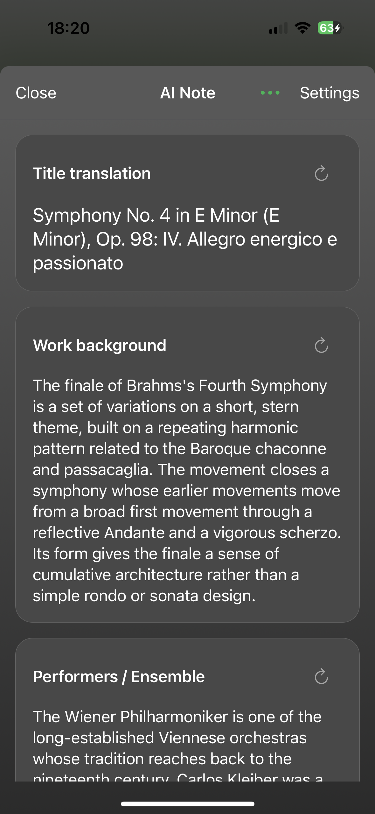
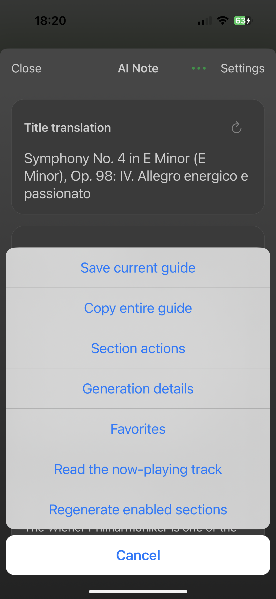
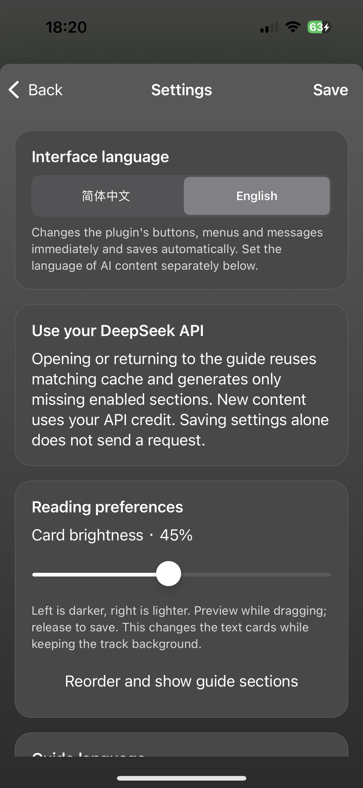
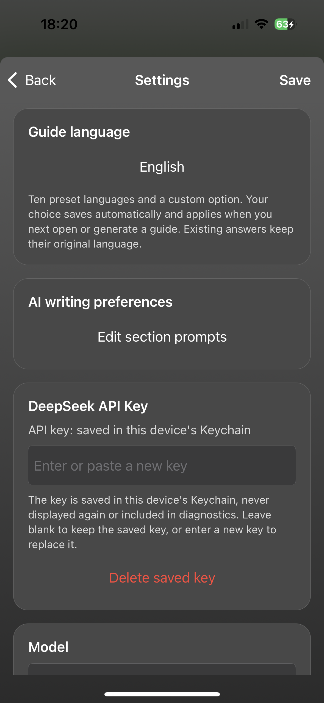

# AI Note for Spotify

**AI listening notes for classical music, right inside Spotify on iPhone.**

Tap **Guide** on the Now Playing screen to translate long track titles, understand the work, and learn about the performers—all without leaving your music.

[**Download**](https://github.com/shuke12306/ai-note-for-spotify/releases/latest) · [**Watch the demo · 65 seconds**](https://github.com/shuke12306/ai-note-for-spotify/blob/main/media/demo.mp4) · [简体中文](README.zh-CN.md)

## See it in action

<table>
  <tr>
    <td align="center"><b>Open from Now Playing</b></td>
    <td align="center"><b>Read the guide</b></td>
  </tr>
  <tr>
    <td></td>
    <td></td>
  </tr>
</table>

## What you can do

- **Understand the music:** title translation, title breakdown, work background, listening tips, and performer/ensemble introductions.
- **Make it yours:** reorder or hide sections, edit their prompts, and regenerate a single section.
- **Choose your language:** English or Simplified Chinese interface; 10 preset languages plus a custom option for AI-generated notes.
- **Keep useful guides:** local caching, saved favorites for offline reading, and copying to share elsewhere.

<b>More screenshots: actions and settings</b>

  
  
  

## Get started

Requires **Spotify on iOS with working TrollFools injection** and **your own DeepSeek API key**. Tested on Spotify **9.1.60 (916001969)**; other versions are unverified.

1. Download `AINote-1.1.0.dylib` from [Releases](https://github.com/shuke12306/ai-note-for-spotify/releases/latest) and inject it with TrollFools. Keep only one copy; remove the old `ClassicalGuide` plugin if present.
2. Play a song, open the full Now Playing screen, and tap **Guide**.
3. Enter your DeepSeek key in **Settings** and choose the guide language. API usage is billed to your DeepSeek account.

AI notes are generated from track metadata and can contain errors. Requests go directly to DeepSeek; your key is stored in the device's Keychain. This is an independent project, not affiliated with Spotify.

[Build from source](docs/BUILDING.md) · [Privacy](docs/PRIVACY.md) · [Compatibility & testing](docs/TESTING.md) · [Report an issue](https://github.com/shuke12306/ai-note-for-spotify/issues) · [MIT License](LICENSE) · [Credits](ACKNOWLEDGMENTS.md)
